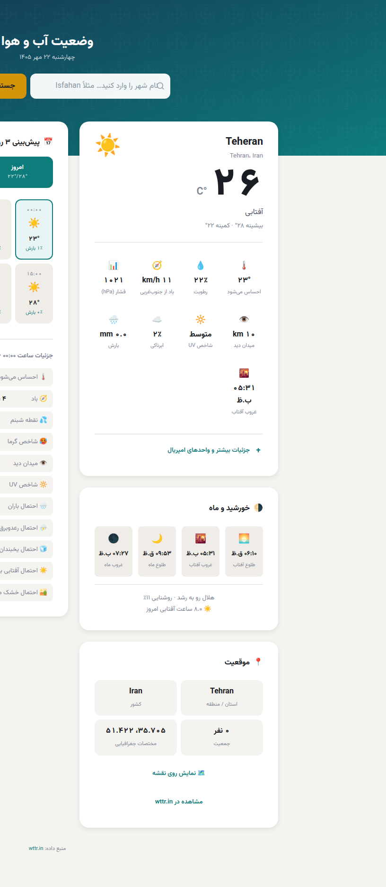

# آب و هوا 🌤️ (Persian Weather Dashboard)

داشبورد آب‌وهوای فارسی با رابط کاربری راست‌به‌چپ (RTL)، تم روشن/تاریک، تاریخ شمسی و پیش‌بینی چندروزه — بدون هیچ فریم‌ورکی، فقط با PHP و JavaScript خالص.



A Persian (Farsi) RTL weather dashboard with dark/light theme, Jalali calendar, and multi-day forecasts — framework-free, just PHP and vanilla JavaScript.

## ✨ امکانات | Features

- 🌐 رابط کاملاً فارسی و راست‌به‌چپ با فونت **وزیرمتن**
- 🌗 تم روشن/تاریک — تشخیص خودکار از سیستم + ذخیره انتخاب کاربر
- 📅 تاریخ **شمسی (جلالی)** و اعداد فارسی
- 🌡️ وضعیت لحظه‌ای: دما، دمای محسوس، رطوبت، باد، فشار، دید، UV
- 📆 پیش‌بینی چندروزه به‌همراه جزئیات **ساعتی** هر روز
- 🌙 اطلاعات نجومی: طلوع/غروب خورشید و ماه، فاز ماه
- 📍 پشتیبانی از **موقعیت مکانی کاربر** (Geolocation)
- ⚡ **کش سمت سرور** (۱۰ دقیقه) برای کاهش درخواست‌ها و سرعت بیشتر
- 🗺️ آدرس کامل فارسی با واژه‌نامه‌خوانی معکوس (Nominatim / OpenStreetMap)
- ♿ دسترس‌پذیری: ARIA، ناوبری با کیبورد، skip link

## 🧱 معماری | Architecture

| فایل | نقش |
|---|---|
| `index.php` | فرانت‌اند تک‌فایلی: رابط کاربری، تم، تقویم شمسی، رندر پیش‌بینی |
| `get_weather.php` | پراکسی سمت سرور برای [wttr.in](https://github.com/chubin/wttr.in) با کش فایل و خروجی JSON یکدست |

فرانت‌اند هرگز مستقیم با سرویس‌های خارجی حرف نمی‌زند؛ همه درخواست‌ها از پراکسی PHP عبور می‌کنند (امنیت + کش + یکدست‌سازی داده).

## 🚀 اجرا | Getting Started

نیازمندی: **PHP 8+** (افزونه cURL اختیاری ولی توصیه‌شده)

```bash
# اجرای محلی با وب‌سرور داخلی PHP
php -S localhost:8000
```

سپس مرورگر را روی `http://localhost:8000` باز کنید.

برای محیط production کافی است فایل‌ها را روی هر هاست PHP (cPanel، Apache، Nginx + PHP-FPM) کپی کنید. پوشه `cache/` به‌صورت خودکار ساخته می‌شود؛ مطمئن شوید قابل نوشتن است.

## 🔌 API

`GET get_weather.php?location=<شهر یا lat,lon>`

```
get_weather.php?location=Tehran
get_weather.php?location=35.70,51.42
```

خروجی همیشه JSON است؛ در صورت موفقیت `ok: true` به‌همراه وضعیت لحظه‌ای، پیش‌بینی روزانه/ساعتی و اطلاعات نجومی، و در صورت خطا `ok: false` با پیام فارسی.

## 🙏 Credits

- داده آب‌وهوا: [wttr.in](https://github.com/chubin/wttr.in)
- ژئوکدینگ معکوس: [Nominatim](https://nominatim.org/) / OpenStreetMap
- فونت: [Vazirmatn](https://github.com/rastikerdar/vazirmatn)

## 🌐 سازنده | Made by

ساخته‌شده توسط **[تایمیت — timit.ir](https://timit.ir/)** — مرجع آموزش وردپرس فارسی و خدمات طراحی سایت، سئو و دیجیتال مارکتینگ. 💙

Built by **[Timit — timit.ir](https://timit.ir/)** — Persian WordPress education, web design, SEO & digital marketing.

## 📄 License

MIT — see [LICENSE](LICENSE).
